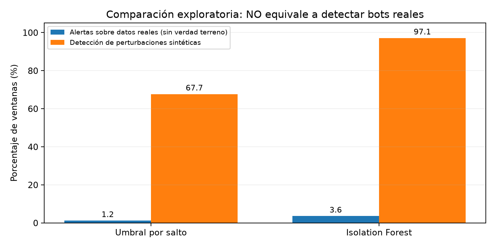

# Detección de patrones anómalos de audiencia en transmisiones en vivo

**Trabajo práctico integrador — Inteligencia Artificial — Universidad de Palermo**

## Pregunta de investigación

¿Puede una técnica de aprendizaje automático no supervisado identificar **alteraciones inusuales en la evolución de espectadores concurrentes** que justifiquen revisar una transmisión por posible manipulación de audiencia (*viewbotting*)?

**Este trabajo NO detecta ni confirma bots reales.** Solo propone un sistema de alertas, estudia series temporales reales y prueba escenarios de perturbación **sintética**. No se recomienda aplicar sanciones a creadores basándose únicamente en un puntaje de anomalía.

## Datos y procedencia

Se utiliza **YTLive: A Dataset of Real-World YouTube Live Streaming Sessions**, un conjunto público de audiencia de YouTube Live publicado por Mozhganfar y colaboradores (NOMS 2026).

- [Repositorio original YTLive](https://github.com/ghalandar/YTLive).
- [Archivo de espectadores de origen (`viewers.csv`)](https://github.com/ghalandar/YTLive/blob/a9ce70a470ddfdd52619a4f110bd33a8fcc1d5df/viewers.csv).
- Versión específica utilizada: [commit `a9ce70a`](https://github.com/ghalandar/YTLive/commit/a9ce70a470ddfdd52619a4f110bd33a8fcc1d5df).
- Observaciones disponibles: **507.290** mediciones, agrupadas en **12.156** transmisiones (resultado de procesar el archivo).
- Variables de origen: momento de medición (`Timestamp` o primera columna del archivo), identificador seudonimizado de transmisión (hash en encabezado) y espectadores concurrentes.
- **No hay etiquetas que identifiquen transmisiones con viewbotting ni datos de sesiones individuales.**
- Como el repositorio fuente **no especifica una licencia de redistribución**, **no republicamos su CSV**. El programa descarga el archivo público directamente de la versión fijada; así los datos siguen siendo accesibles mediante Git, con atribución y sin crear una copia en nuestro repositorio.

## Ejecutar

Requiere Python 3.11 e Internet durante la descarga inicial. El programa verifica el archivo obtenido mediante SHA-256 y, en ejecuciones posteriores, reutiliza el caché únicamente si coincide con la versión original auditada:

```bash
python -m pip install -r requirements.txt
python main.py
python -m unittest discover -s tests -v
```

El programa crea un caché local ignorado por Git en `data/origen/viewers.csv`, calcula el modelo y genera gráficos y resultados. No hacen falta claves de YouTube ni acceso a servidores de streaming.

**Los mismos archivos de salida ya están versionados** y pueden consultarse sin ejecutar nada:

- [Métricas generales](resultados/metricas.csv)
- [Desglose por escenario](resultados/escenarios.csv)
- [Información del dataset y configuración](resultados/resumen.json)
- [Ejemplo de alteración de audiencia](graficos/ejemplo_escenario_simulado.png)
- [Comparación de los métodos](graficos/comparacion_metodos.png)
- [Resultados por tipo de simulación](graficos/escenarios_simulados.png)



## Resultados de la ejecución verificada

Se analizaron **421 ventanas reales sin etiquetas** (55 transmisiones de prueba), y para cada una se produjo una versión alterada de forma sintética.

| Indicador | Regla por salto | Isolation Forest |
|---|---:|---:|
| Ventanas reales con alerta (de 421) | 5 (1,2 %) | 15 (3,6 %) |
| Perturbaciones sintéticas señaladas (de 421) | 285 (67,7 %) | 409 (97,1 %) |
| Nuevas alertas respecto de la ventana sin alterar (de 421) | 280 (66,5 %) | 395 (93,8 %) |
| Escalón artificial (de 141) | 141 | 139 |
| Pulso artificial (de 140) | 140 | 139 |
| Rampa artificial (de 140) | 4 | 131 |

**Interpretación:** el porcentaje del 97,1 % solo expresa sensibilidad a las perturbaciones sintéticas de este protocolo. Las ventanas originales no están verificadas como libres de manipulación: por eso el 3,6 % **no es una tasa de falsos positivos**. Tampoco existe información para calcular precisión, F1 o recall de bots reales. La tercera fila (análisis por pares) distingue una alerta nueva de otra que ya existía antes de introducir la perturbación.

Estos valores están respaldados por [métricas CSV](resultados/metricas.csv), [detalle por escenario](resultados/escenarios.csv) y una [ejecución de GitHub Actions](https://github.com/kevinefraim/tp-ia-streaming/actions). No son conclusiones transferibles directamente a entornos productivos.

## Reproducibilidad y calidad

- Origen fijado por commit `a9ce70a470ddfdd52619a4f110bd33a8fcc1d5df`.
- **SHA-256 verificado**: `ceaf80834da37d8dbaea04386d55034f044458af9f95f20d7b37a02d9778b3e5`.
- Las particiones de entrenamiento y prueba se realizan **por transmisión**, para evitar compartir ventanas del mismo live.
- Semilla 42 para la muestra y el modelo; semilla 59 para la intensidad de las perturbaciones.
- Umbrales calibrados exclusivamente con ventanas de entrenamiento (percentil 95).
- Incluye [pruebas unitarias](tests/test_experimento.py) sobre características, simulaciones deterministas y métricas, ejecutadas automáticamente en CI.
- La intensidad artificial se elige entre 80 % y 220 % de la mediana de espectadores (con piso de 30); son casos deliberadamente marcados y pueden resultar más fáciles de identificar que el fraude real.

## Diseño del experimento

1. Descargar el archivo `viewers.csv` desde un **commit fijo** del repositorio YTLive, sin modificarlo.
2. Convertir el formato original ancho (transmisiones como columnas) en observaciones `(transmisión, fecha, espectadores)`; eliminar registros inválidos y duplicados de fecha.
3. Separar tramos continuos de mediciones y construir ventanas de **ocho observaciones** (intervalos aproximados de cinco minutos; ventana de ~35 minutos entre extremos). Las celdas vacías **no se consideran cero espectadores**.
4. Seleccionar de forma reproducible **180 transmisiones elegibles** y dividir las transmisiones (no las ventanas) **70 % entrenamiento / 30 % prueba**, evitando mezclar ventanas de un mismo live en ambas partes.
5. Construir siete características por ventana: volumen mediano de audiencia, máximo salto hacia arriba, máximo salto hacia abajo, rango relativo, dispersión relativa, diferencia entre inicio y final, y cambio neto relativo.
6. Entrenar `IsolationForest` sin etiquetas, con 150 árboles, submuestras de 256 ventanas (o menos si no alcanzan) y semilla 42.
7. Comparar con una regla de referencia que utiliza solamente el **máximo salto positivo relativo**.
8. Definir el umbral de cada método usando el **percentil 95 de las puntuaciones del conjunto de entrenamiento**, antes de mirar los datos de prueba.
9. Para cada ventana real de prueba generar una versión **alterada artificialmente** de tres formas, según una asignación determinística: **escalón** (subida sostenida), **pulso** (subida seguida por baja) y **rampa** (subida progresiva). La magnitud se elige mediante una semilla conocida. Son perturbaciones matemáticas, **no tráfico generado por bots**.
10. Evaluar por separado:
    - **Tasa de alertas sobre ventanas reales sin etiquetas**. No equivale a tasa de falsos positivos, ya que nadie certificó que esas transmisiones sean legítimas.
    - **Porcentaje detectado de escenarios sintéticos**, total y por tipo. Sirve para comparar sensibilidad frente a las perturbaciones artificiales, **no para estimar recall de bots reales**.

No calculamos precisión, F1 ni exactitud de detección de bots reales porque **no tenemos verdad terreno**. Cualquier métrica en este experimento debe interpretarse solo en el ámbito delimitado anteriormente.

## Limitaciones

- Se trabaja con espectadores agregados: sin IP, sesiones, comportamiento de cuentas ni actividad de chat.
- Un pico puede ser legítimo: viralidad, promociones, coberturas de eventos y cambios de fuentes de tráfico. La detección nunca es prueba de fraude.
- La selección de 180 transmisiones es una **muestra de conveniencia reproducible**; los resultados no pueden generalizarse automáticamente a todas las plataformas.
- Las perturbaciones sintéticas no reproducen necesariamente estrategias reales de evasión.
- El experimento es **offline** y no incluye despliegue productivo, panel de alertas o revisión operativa.

## Trabajos relacionados

- Shah, N. (2017). *FLOCK: Combating astroturfing on livestreaming platforms*. Proceedings of the 26th International Conference on World Wide Web, 1083–1091. https://doi.org/10.1145/3038912.3052617
- Mozhganfar, M., Jamshidi, P., Aghamiri, S. A., Ghasemi, M., Dolati, M., Tashtarian, F., Khonsari, A., & Timmerer, C. (2026). *YTLive: A dataset of real-world YouTube live streaming sessions*. IEEE/IFIP NOMS. https://arxiv.org/abs/2510.24769
- Liu, F. T., Ting, K. M., & Zhou, Z.-H. (2008). Isolation forest. *2008 Eighth IEEE International Conference on Data Mining*, 413–422. https://doi.org/10.1109/ICDM.2008.17
- Twitch. (s. f.). [*How to handle viewership botting and fake engagement*](https://help.twitch.tv/s/article/how-to-handle-view-follow-bots?language=en_US).

## Aclaración

El enfoque de este repositorio es académico y explicable: su producto es una **lista de alertas para revisión humana**, no un clasificador determinista de espectadores fraudulentos.
